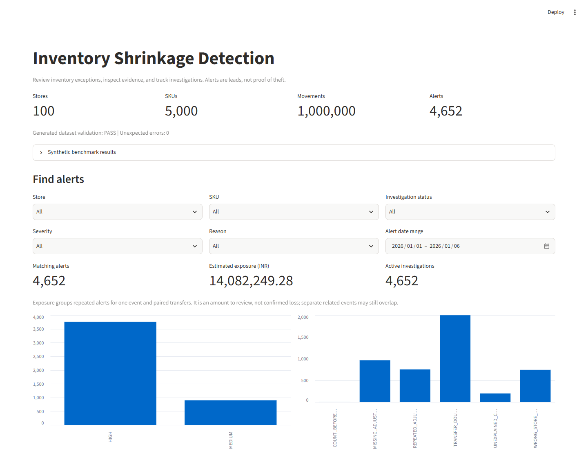
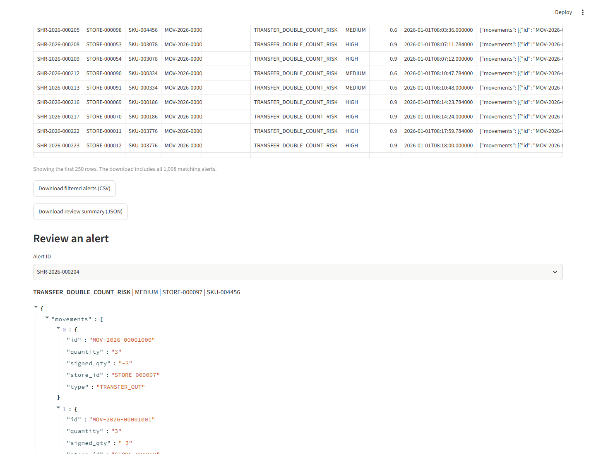
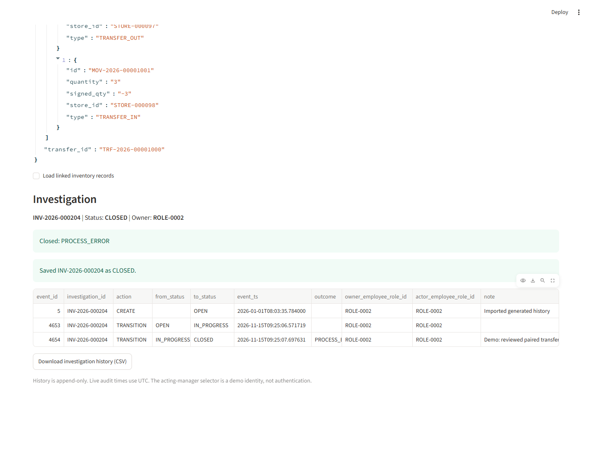

# Demonstration guide

Allow about five minutes. Launch `streamlit run app.py` after generating data and running validation/evaluation, or use the bundled sample as described in examples/README.md.

1. **Explain the problem (30 seconds).** Inventory loss can come from damage, returns, transfer errors, count timing or unexplained shortages. The system compares an event ledger with physical counts and creates reviewable leads.
2. **Show the overview (45 seconds).** Point out the dataset volume and generated-data validation result. Open Synthetic benchmark results. Explain that scores measure the planted benchmark and are not a guarantee of real-world accuracy.
3. **Find an exception (45 seconds).** Filter Reason to TRANSFER_DOUBLE_COUNT_RISK. Try store, SKU, date, severity and investigation status. Download the filtered CSV and JSON review summary. Explain that estimated exposure deduplicates transfer pairs, but is not confirmed loss.
4. **Inspect evidence (45 seconds).** Select an Alert ID. Show the paired movement IDs and negative destination quantity. Check Load linked inventory records to inspect the underlying source rows. For count-shortage alerts, show expected, counted and variance quantities.
5. **Work the case (60 seconds).** In Investigation, change Assign owner to ROLE-0005 and save while keeping OPEN. Advance to IN_PROGRESS and save. Then choose CLOSED, resolution PROCESS_ERROR, and enter notes such as "Compared both transfer records; destination was debited instead of credited. Request a correction." Save. Closed cases become read-only. Download the full audit history and refresh to show persistence. Use a different active case if this one was previously closed.
6. **Explain traceability (30 seconds).** Each update records the acting manager, owner, old/new status, timestamp, outcome and note. Source CSVs remain reproducible. Live changes are stored separately and protected against stale simultaneous updates.
7. **Close with verification (30 seconds).** Show docs/VERIFICATION.md, the field dictionary and the ER diagram. Explain that baseline constraints and exact planted exceptions are checked separately, and benign damage/returns are evaluated explicitly.

## Screenshots from the actual app

Screenshots use the full dataset and an isolated temporary investigation database. They demonstrate a review session and do not change user investigations.

Recapture with `py -m pip install -r requirements-dev.txt`, then `py scripts/capture_demo.py`. The script uses an installed Microsoft Edge browser, a temporary local server and a temporary workflow database. It also checks CSV/JSON downloads and a complete investigation transition.
