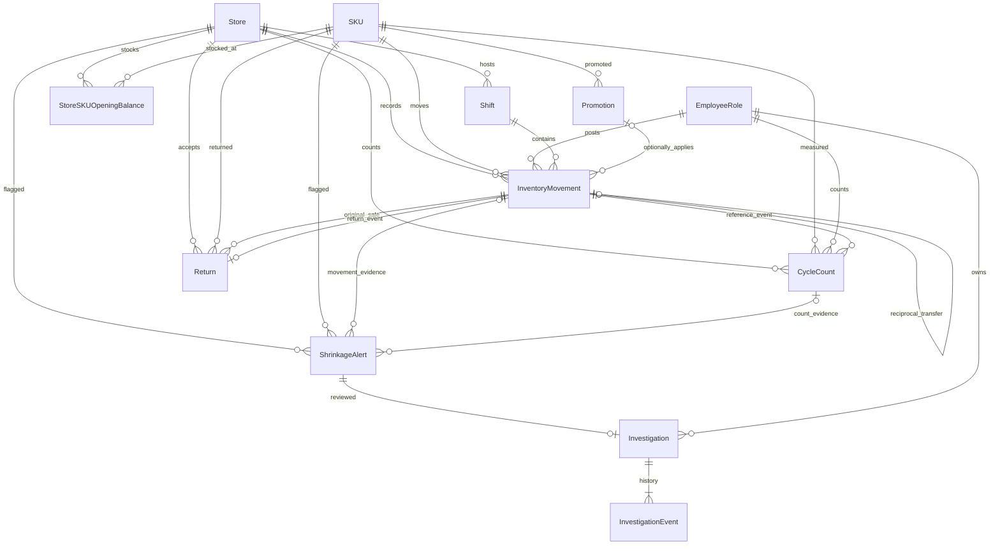
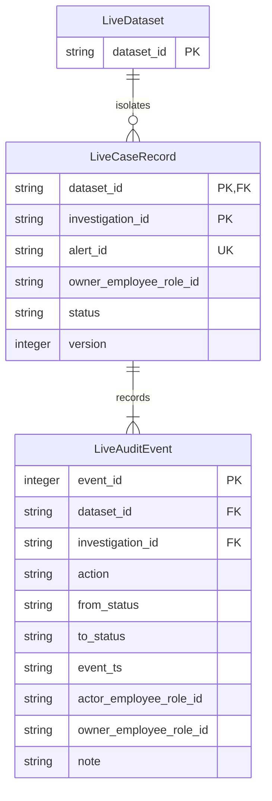

# Entity relationships

- Store and SKU are N:M through StoreSKUOpeningBalance, whose composite key is (store_id, sku_id).
- A movement has exactly one store, SKU, shift and actor role. Promotion is optional. Its reciprocal movement is required only for transfers. A valid transfer group contains one TRANSFER_OUT and one TRANSFER_IN at different stores.
- Every count references one movement of the same store/SKU. Its expected quantity is derived independently as of the count timestamp.
- A sale may have multiple returns; each RETURN movement has at most one Return entity, and all generated return movements have exactly one. Return quantities cannot exceed their source sale in aggregate.
- Each alert references exactly one movement or count (exclusive relationship). Both are drawn as optional because the other evidence type can be used.
- An alert has zero or one investigation; generation initializes one for every alert. An investigation has at least one state event.
- IDs and master snapshots are immutable within a generated dataset. Store/SKU active flags express master lifecycle; promotions have start/end dates, shifts a date/time interval. Effective-dated employee assignments are outside this prototype.

## Persistent review model

The live alert key is unique **within a dataset**. A fingerprint of baseline alerts, investigations, events and role records selects the namespace. Regeneration with identical bytes resumes that namespace; a changed baseline creates another namespace and keeps the old audit history. Live snapshots use source CSV IDs and are joined to alerts at display time. The source manifest and checksum evidence remain unchanged by user review.

State transitions: OPEN -> IN_PROGRESS -> CLOSED. Owner reassignment is allowed while active and appends an ASSIGN event without changing status. Closed cases are read-only. Closing requires a documented resolution and notes. Each write atomically updates the snapshot and appends its event; stale version tokens are rejected.
